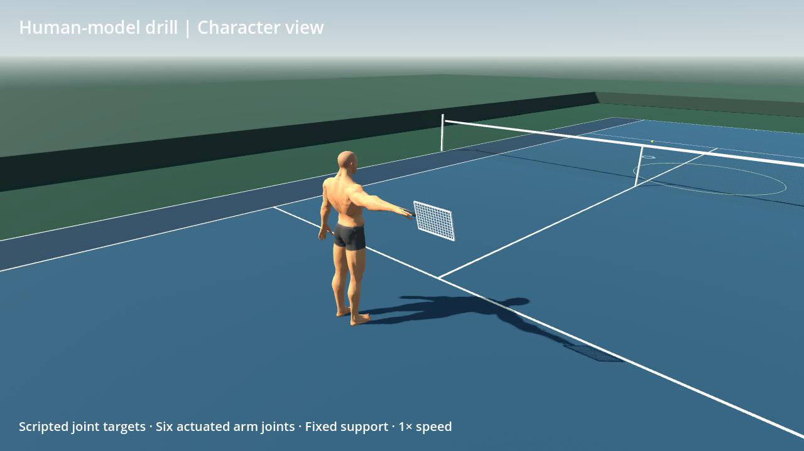
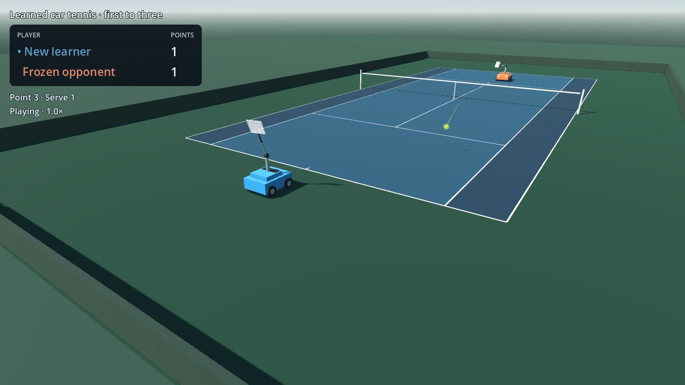

# SimTennis

SimTennis combines physical simulation and reinforcement learning to study
learned tennis play. Its long-term goal is to model human biomechanics and
ball–racket interaction for studying tennis technique and robot control.

## Demos

### Stage 1 — Human-model drill

[](media/human-model.mp4)

A supported six-axis arm couples physical racket motion to a rigged human character.

### Stage 2 — Learned car-and-racket play

[](media/competitive-play.mp4)

Learned return policies coordinate car movement and racket rotation during competitive play.

## Method

MuJoCo simulates player motion and ball contacts. A policy receives a
34-dimensional player-relative observation and commands two planar forces and two racket
torques at 50 Hz. Ball trajectories follow the simulated dynamics and contacts.

PPO, implemented in Stable-Baselines3, trains separate policies for serve returns
and later incoming shots. The combined controller selects between them using
point history. Evaluation freezes both policies and compares them with the
baseline on matched cases. Recorded actions are replayed through the native
simulator to verify states, contacts and scores.

## Results

The baseline and combined controller were evaluated on matched cases unused
during policy selection. Eight contests covered two frozen opponents, both
opening servers and both court ends.

| Measurement | Baseline | Combined policy |
|---|---:|---:|
| Legal serve returns | 31/32 | 31/32 |
| Legal later returns | 6/34 | 12/34 |
| First-to-three contests won | 6/8 | 8/8 |


[Evaluation protocol and limitations](docs/evaluation.md)

## Setup

Tested on macOS with Apple Silicon. Requires Python 3.11, `uv`, CMake and a C++17
toolchain. From the repository root:

```sh
uv sync --frozen
uv run python tools/build.py deps
uv run python tools/build_return_policy.py
```

## Run the demos

Download [simtennis-demo.tar.gz](https://github.com/SotaZoo/SimTennis/releases/download/v0.1.0/simtennis-demo.tar.gz) and extract it into the repository
root. It supplies the `demo/` directory with recorded contests and checkpoints.

Load only checkpoints from this official release or another trusted source.
Stable-Baselines3 checkpoints use pickle deserialization, which can execute code.

```sh
tar -xzf simtennis-demo.tar.gz
uv run python -m simtennis replay demo/after.json
uv run python -m simtennis view demo/after.json
```

**Space** pauses, **N/P** switches points, **C** switches cameras, and **H** shows
diagnostics.

Run the human-arm drill:

```sh
uv run python tools/human_drill.py
```

## Reproduce the results

```sh
uv run python -m simtennis.evaluate --output .scratch/evaluation
```

This loads the three supplied checkpoints and repeats the paired evaluation.
Choose a new output directory for each run. Training runs and development
history are outside this release.

## Verification

```sh
ctest --test-dir .scratch/rl-build --output-on-failure
uv run python -m unittest discover -s tests
uv run python -m simtennis view demo/after.json --check
uv run python tools/human_drill.py --check
```

## Repository layout

| Directory | Contents |
|---|---|
| `native/`, `models/` | MuJoCo simulation and physical models |
| `simtennis/` | Return tasks, policy inference, evaluation and replay |
| `godot/` | Competitive replay and human-arm visualization |
| `tools/`, `tests/` | Dependency setup, builds and verification |
| `media/`, `docs/` | Demo videos and evaluation protocol |
| `assets/` | Character model and third-party notices |

## References

[MuJoCo](https://mujoco.org/) · [Stable-Baselines3](https://github.com/DLR-RM/stable-baselines3) · [Godot](https://godotengine.org/) · [Third-party attribution](assets/README.md)

## License

Original code and research assets are licensed under
[Creative Commons Attribution–NonCommercial 4.0 International](LICENSE).
Third-party components retain their original licenses; see
[third-party attribution](assets/README.md).
